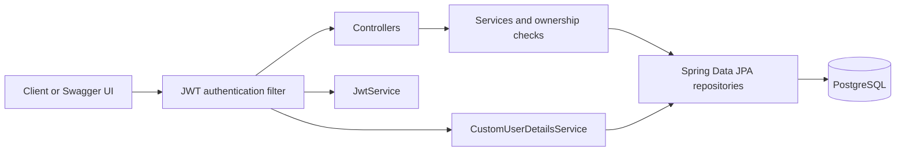
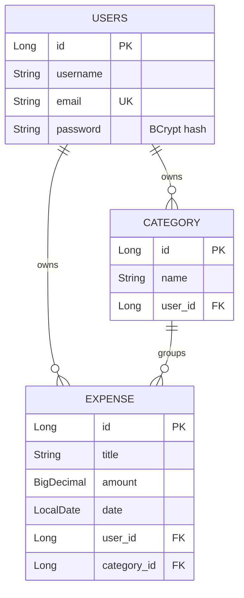
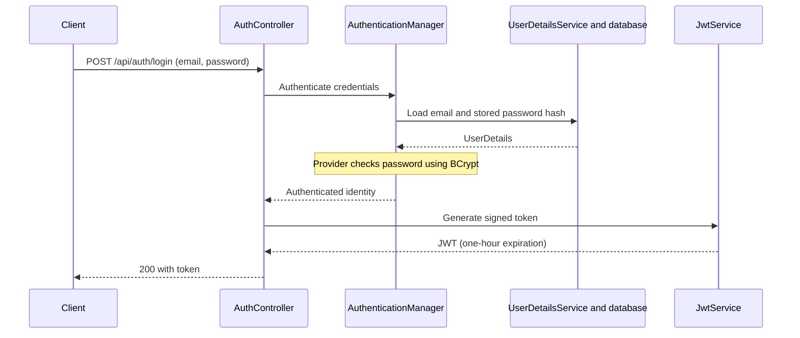

# Expense Tracker API

Project 3 in a daily Spring Boot backend development challenge. A REST API where authenticated users manage their own expenses and categories, filter spending, and calculate totals.

## Features

- Registration and login with BCrypt password hashing and JWT authentication.
- Create categories and list only your own categories.
- Reject duplicate category names for the same user, ignoring case; different users can share a category name.
- Create, list, retrieve, update, and delete your own expenses.
- Filter expenses by category, date range, minimum amount, or a combination.
- Calculate your total spending, optionally restricted to a category.
- Request validation and exception responses for conflicts and missing resources.
- Interactive Swagger UI with Bearer token authorization.

## Technology

Java 17, Spring Boot 4.1.1, Spring MVC, Spring Security, Spring Data JPA, Jakarta Validation, PostgreSQL 17, JJWT 0.12.6, springdoc OpenAPI 3.1.0, Maven Wrapper, and Docker Compose.

## Architecture



Controllers handle HTTP requests and responses. Services apply business rules, resolve the current user, and map entities to DTOs. Repositories read and write database records.

## Entity relationships



Each expense belongs to one user and one category. Amounts use `BigDecimal`; expense dates use `LocalDate`. The database stores foreign keys on the many-to-one side.

## Authentication and ownership



Send `Authorization: Bearer <token>` on protected requests. The JWT filter verifies the token and places the email and authorities in Spring Security's context.

The client never supplies a user ID to assign ownership. Services resolve the user from the authenticated email. Expense lookup, update, and deletion use both expense ID and user ID. Category selection during creation and update also checks category ID and user ID. Missing resources and resources owned by someone else return 404 for these lookups.

## Run locally

1. Install a JDK compatible with Java 17 and Docker Desktop. Start Docker Desktop and wait for its Linux engine to be ready.
2. Clone the repository and enter it:

   ```powershell
   git clone https://github.com/iiMedR/ExpenseTrackerAPI_SpringBoot.git
   cd ExpenseTrackerAPI_SpringBoot
   ```

3. Create `.env` in the project root:

   ```properties
   POSTGRES_URL=expense_tracker
   POSTGRES_USER=expense_tracker
   POSTGRES_PASSWORD=replace_with_your_local_password
   JWT_SECRET=replace_with_a_random_secret
   ```

   `POSTGRES_URL` contains the database name, not a URL. `.env` is excluded from Git. The current implementation uses the UTF-8 bytes of `JWT_SECRET` as its signing key; use a high-entropy value at least 32 bytes long. For example, generate a random value in PowerShell and copy the output into `.env`:

   ```powershell
   $jwtBytes = New-Object byte[] 32
   $jwtRng = [System.Security.Cryptography.RandomNumberGenerator]::Create()
$jwtRng.GetBytes($jwtBytes)
$jwtRng.Dispose()
   [Convert]::ToBase64String($jwtBytes)
   ```

4. Start PostgreSQL and the application from the project root:

   ```powershell
   docker compose up -d
   .\mvnw.cmd spring-boot:run
   ```

   On macOS/Linux, use `./mvnw spring-boot:run`. PostgreSQL is exposed on port 5433 and persists data in a named Docker volume. Hibernate uses `ddl-auto=update` for local schema creation and updates.

5. Open [Swagger UI](http://localhost:8080/swagger-ui/index.html). Register, log in, then use **Authorize** to enter the token returned by login. OpenAPI JSON is available at `/v3/api-docs`.

## Endpoints

Base URL: `http://localhost:8080`. Category and expense endpoints require a Bearer token.

| Method | Endpoint | Purpose | Success |
| --- | --- | --- | --- |
| POST | `/api/auth/register` | Register a user | 201 |
| POST | `/api/auth/login` | Authenticate and receive a JWT | 200 |
| POST | `/api/categories` | Create an owned category | 201 |
| GET | `/api/categories` | List your categories | 200 |
| POST | `/api/expenses` | Create an owned expense | 201 |
| GET | `/api/expenses` | List/filter your expenses | 200 |
| GET | `/api/expenses/{id}` | Retrieve your expense | 200 |
| PUT | `/api/expenses/{id}` | Replace editable expense fields | 200 |
| DELETE | `/api/expenses/{id}` | Delete your expense | 204 |
| GET | `/api/expenses/total` | Calculate your spending | 200 |

### Register and login

Registration request:

```json
{"username":"reda","email":"reda@example.com","password":"password123"}
```

Registration returns ID, username, and email. Login accepts email and password:

```json
{"email":"reda@example.com","password":"password123"}
```

Login response:

```json
{"token":"<jwt>"}
```

### Categories and expenses

Create a category:

```json
{"name":"Food"}
```

Create or update an expense (all four fields are required):

```json
{
  "title":"Lunch",
  "amount":65.50,
  "date":"2026-10-12",
  "categoryId":1
}
```

Expense response:

```json
{
  "id":1,
  "title":"Lunch",
  "amount":65.50,
  "date":"2026-10-12",
  "categoryId":1
}
```

Titles must be nonblank, amounts must be positive, and dates/category IDs must be supplied. Category names must be nonblank and at most 50 characters. Responses exclude user entities and password hashes.

### Filtering and totals

All filters are optional and combine with AND. Date boundaries and the minimum amount are inclusive. Dates use `yyyy-MM-dd`.

```text
GET /api/expenses?categoryId=1
GET /api/expenses?startDate=2026-10-01&endDate=2026-10-31
GET /api/expenses?minAmount=50
GET /api/expenses?categoryId=1&startDate=2026-10-01&minAmount=50
GET /api/expenses/total
GET /api/expenses/total?categoryId=1
```

Totals use a database `SUM` query with `COALESCE` to return zero when no expenses match:

```json
{"total":65.50}
```

A category belonging to another user matches no expenses for the authenticated user; listing returns an empty array and totals return zero.

## Error responses

| Status | Cases |
| --- | --- |
| 400 | Invalid request fields or parameter format |
| 401 | Invalid login credentials or unauthenticated protected request |
| 404 | Expense/category unavailable to the current user; current user not found |
| 409 | Email already registered or category name already used by that user |

Custom controller exception responses include status, message, and timestamp. The security entry point returns status and message. Example failed login:

```json
{"status":401,"message":"Invalid email or password","timestamp":"2026-10-12T12:00:00"}
```

## Verification

All core endpoints are implemented. Final end-to-end verification remains pending; this README does not claim that the complete test checklist has passed.

- Register and log in as two different users.
- Confirm missing, invalid, and expired tokens cannot access protected endpoints.
- Create categories for both users and verify their lists are separate.
- Verify a duplicate category name is rejected for one user but allowed for another.
- Create, retrieve, update, and delete an expense as its owner.
- Verify another user cannot retrieve, update, or delete that expense, or use its category.
- Test date boundaries, individual filters, combined filters, and totals with/without a category.
- Verify users without expenses receive an empty list and a zero total.
- Verify blank titles, nonpositive amounts, and missing required fields are rejected.

The existing test suite contains an application-context smoke test. Run it with `./mvnw test` or `.\mvnw.cmd test`; the configured database and Docker environment must be available.

## Current scope

This is a learning project focused on authentication, relationships, queries, validation, and ownership. Duplicate category checks are performed in the service and are not protected against concurrent duplicate requests by a database uniqueness constraint. Reversed date ranges currently return an empty list. The security configuration does not yet explicitly permit error dispatches, so unhandled errors may be masked by a 401 response.

Pagination, refresh tokens, budgets, recurring expenses, and currency conversion are outside the project scope.
